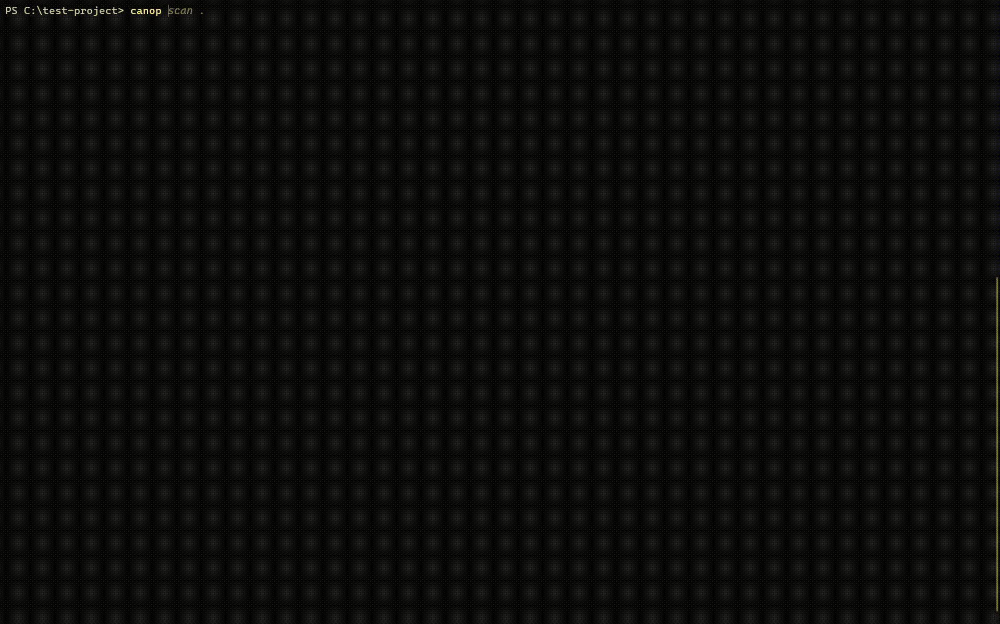
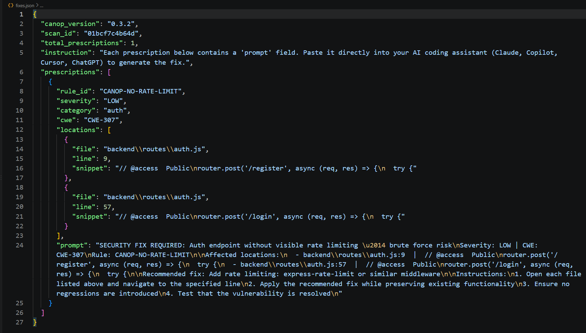

# CanoP CLI

<p align="center">
  <picture>
    <source media="(prefers-color-scheme: dark)" srcset="docs/assets/canop-logo-light.svg">
    <source media="(prefers-color-scheme: light)" srcset="docs/assets/canop-logo-dark.svg">
    
  </picture>
</p>

[](https://pypi.org/project/canop/)
[](https://opensource.org/licenses/MIT)
[](https://www.python.org/downloads/)
[](https://github.com/psf/black)

A fast, standalone static analysis tool for finding security risks in AI-generated code. CanoP runs locally and produces actionable findings with remediation guidance.

## See CanoP in Action

<p align="center">
  
</p>

<p align="center">
  
</p>

## Features

* **High signal-to-noise**: Targets AI-era risks such as SQL injection, unsafe reflection, and hardcoded secrets.
* **Language support**: Supports Python and JavaScript.
* **CI/CD ready**: Gate builds by severity or security score.
* **AI prescriptions**: Generates `fixes.json` prompts for LLM-assisted remediation.
* **Standard reporting**: Exports JSON and SARIF for GitHub and other security tools.

## Installation

```bash
pip install canop
```

On macOS and Linux, use [pipx](https://pipx.pypa.io/) if global `pip` installation is restricted:

```bash
pipx install canop
```

Verify the installation:

```bash
canop --version
```

## Quick Start

Initialize `.canop.yml` and `.canopignore`:

```bash
canop init
```

Scan the current directory, or only files changed in Git:

```bash
canop scan .
canop scan . --changed
```

Findings are capped at 50 by default. Use `--all` for no cap or `--limit N` for a custom cap:

```bash
canop scan . --all
canop scan . --limit 10
```

## Advanced Usage

### CI/CD

These options return a non-zero exit code when the threshold is not met:

```bash
canop scan . --fail-on HIGH
canop scan . --min-score 85
```

### Exporting Results

```bash
canop scan . --json-out results.json
canop scan . --sarif results.sarif
canop scan . --prescriptions fixes.json
```

The SARIF output can be uploaded to GitHub for inline findings. `fixes.json` contains prompts for LLM-assisted remediation.

## Configuration

Add `.canop.yml` to the project root to define policy thresholds and ignored paths:

```yaml
min_grade: B
fail_on:
  - CRITICAL
  - HIGH
ignore:
  - "tests/**"
  - "docs/**"
max_findings: 0
```

`.canopignore` uses `.gitignore`-style patterns to exclude files and directories.

## How Detection Works

CanoP loads rules from `canop/rules/*.yml` and scans locally with its built-in pattern engine. Secret rules inspect comments to catch credentials accidentally left in frontend source by AI coding agents; other rules ignore comment-only lines to reduce noise. If installed, Semgrep adds AST-based analysis. It is optional and is not installed with CanoP.

## Local Development

```bash
git clone https://github.com/openbreach/CanoP.git canop
cd canop
pip install -e .
python -m unittest discover -s tests -v
```

Build distribution artifacts with:

```bash
pip install -r requirements-dev.txt
python -m build
```

### Rule Development

Rules use Semgrep YAML format and live in `canop/rules/*.yml`. See [`CONTRIBUTING.md`](CONTRIBUTING.md) for guidelines.

## Support

For bugs and feature requests, open a GitHub issue or email canop.security@gmail.com.

## License

This project is licensed under the [MIT License](LICENSE).
